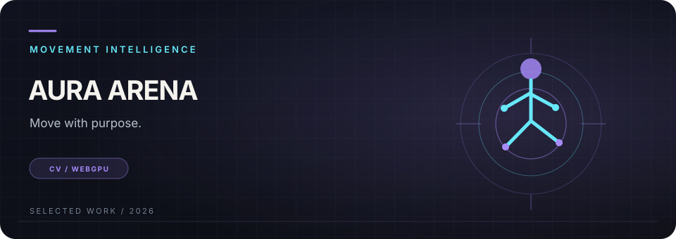
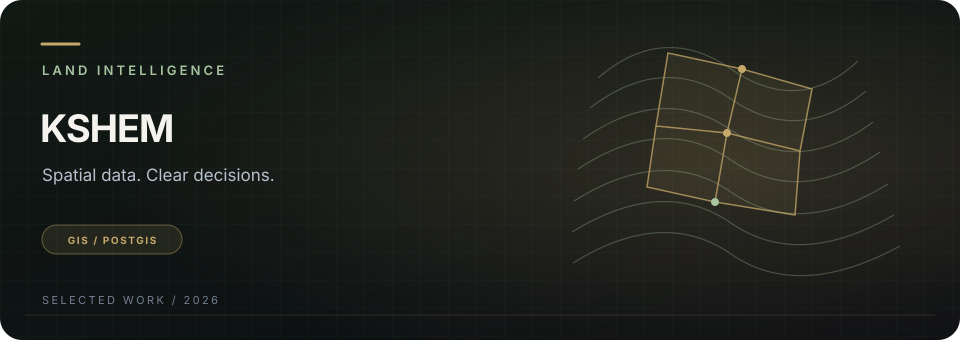
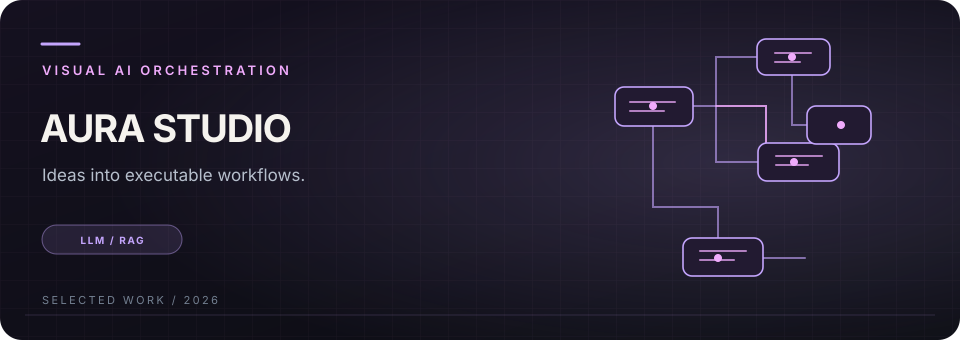
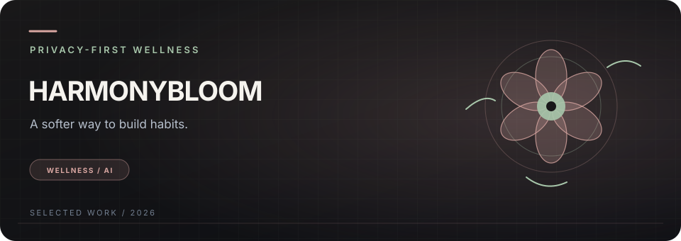
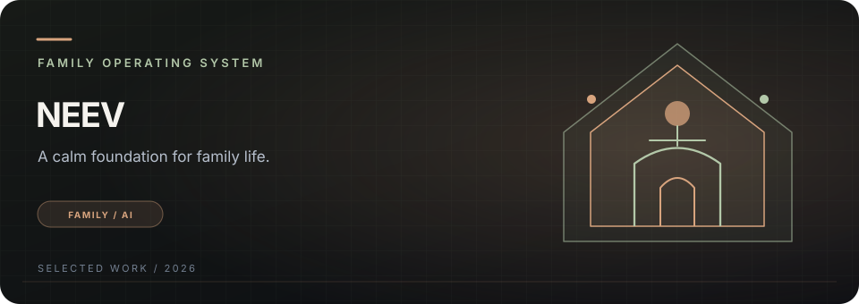
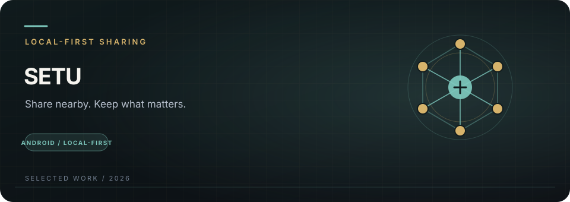
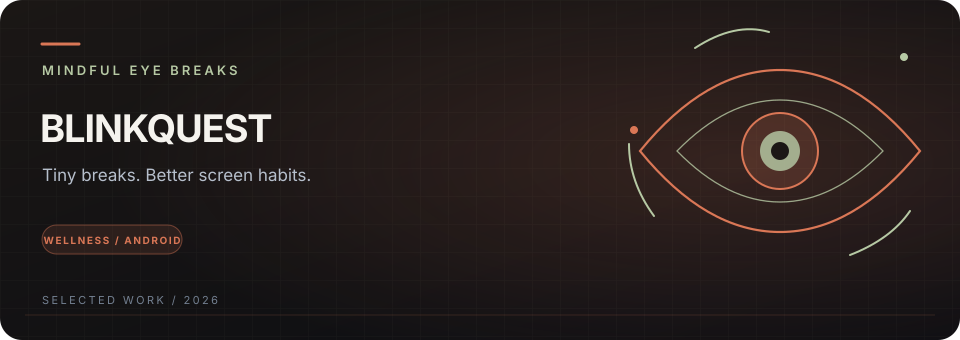
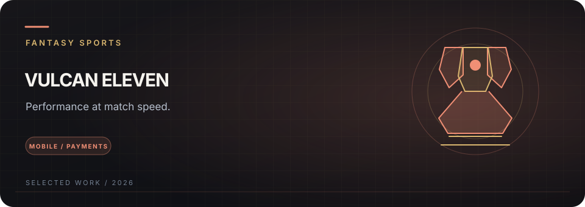

  

  
  
  
  
  

  <a href="#selected-work">Selected work</a> &nbsp;·&nbsp;
  <a href="#product-lab">Product lab</a> &nbsp;·&nbsp;
  <a href="#production-work">Production work</a> &nbsp;·&nbsp;
  <a href="#engineering-toolkit">Toolkit</a> &nbsp;·&nbsp;
  <a href="#writing--notes">Writing</a> &nbsp;·&nbsp;
  <a href="#lets-build">Contact</a>

<em>From system boundaries to the last pixel — I build products for the real world.</em>

---

## The short version

I’m **Amit Chakraborty**, a Lead Architect and Senior Full-Stack Engineer in Kolkata, India, working remotely with teams worldwide. I build mobile and web products, performance-critical native integrations, AI-enabled workflows, and the infrastructure that keeps shipped systems reliable.

My background spans **HealthTech, FinTech, GovTech, consumer products, gaming, and Web3**. I work across product discovery, architecture, implementation, release engineering, and technical leadership — with an emphasis on measurable constraints, privacy, and maintainable delivery.

<table>
  <tr>
    <td align="center" width="25%"><strong>8+ years</strong> Production engineering</td>
    <td align="center" width="25%"><strong>18+ apps</strong> Shipped across platforms</td>
    <td align="center" width="25%"><strong>50K+ users</strong> Across product work</td>
    <td align="center" width="25%"><strong>0 → 21</strong> Team-building experience</td>
  </tr>
</table>

## Selected work

*A visual index of products and systems I’ve architected or built. Follow the case-study links for the product context; follow source links where a public repository is available.*

<table>
  <tr>
    <td valign="top" width="50%">
      
      <h3><a href="https://amitchakraborty.dev/work/aura-arena">01 / Aura Arena</a></h3>
      
<strong>Movement intelligence · Computer vision</strong>

      
Real-time movement experiences using MediaPipe and WebGPU, with live product state and AI-assisted feedback. Designed to keep the inference loop close to the user.

      React · TypeScript · MediaPipe · WebGPU · Supabase Realtime  
      <a href="https://auraarena.devamit.co.in">↗ Product</a> &nbsp;·&nbsp; <a href="https://github.com/devamitch/aura-arena">Source</a> &nbsp;·&nbsp; <a href="https://amitchakraborty.dev/work/aura-arena">Case study</a>
    </td>
    <td valign="top" width="50%">
      
      <h3><a href="https://amitchakraborty.dev/work/kshem">02 / KSHEM</a></h3>
      
<strong>Land intelligence · Spatial workflows</strong>

      
A GIS-led platform concept for land records, boundary analysis, document review, and role-aware governance workflows.

      Next.js · PostGIS · GeoJSON · GIS · AI-assisted analysis  
      <a href="https://kshem.devamit.co.in">↗ Product</a> &nbsp;·&nbsp; <a href="https://amitchakraborty.dev/work/kshem">Case study</a>
    </td>
  </tr>
  <tr>
    <td valign="top" width="50%">
      
      <h3><a href="https://amitchakraborty.dev/work/aura-studio">03 / Aura Studio</a></h3>
      
<strong>Visual AI orchestration · LLM workflows</strong>

      
A node-based canvas for assembling AI and RAG workflows, validating connections, observing execution, and exporting workflow implementations.

      React Flow · TypeScript · Zustand · Gemini · RAG  
      <a href="https://aurastudio.devamit.co.in">↗ Product</a> &nbsp;·&nbsp; <a href="https://github.com/devamitch/aura-workflow-studio">Source</a> &nbsp;·&nbsp; <a href="https://amitchakraborty.dev/work/aura-studio">Case study</a>
    </td>
    <td valign="top" width="50%">
      
      <h3><a href="https://amitchakraborty.dev/work/harmony-bloom">04 / HarmonyBloom</a></h3>
      
<strong>Privacy-first wellness · Habit design</strong>

      
A Telegram Mini App for habit progression and AI-guided reflection, with local persistence and client-side encryption in the product design.

      Telegram Mini App · Dexie · Framer Motion · Gemini · AES-GCM  
      <a href="https://harmonybloom.devamit.co.in">↗ Product</a> &nbsp;·&nbsp; <a href="https://amitchakraborty.dev/work/harmony-bloom">Case study</a>
    </td>
  </tr>
  <tr>
    <td valign="top" width="50%">
      
      <h3><a href="https://amitchakraborty.dev/work/neev">05 / Neev</a></h3>
      
<strong>Family operating system · Private-by-design</strong>

      
A family coordination product with household-scoped spaces, differentiated roles, shared routines, reminders, and carefully bounded AI assistance.

      React Native · Expo · TypeScript · Firebase · Google services  
      <a href="https://neev.devamit.co.in">↗ Product</a> &nbsp;·&nbsp; <a href="https://github.com/devamitch/neev">Mobile source</a> &nbsp;·&nbsp; <a href="https://github.com/devamitch/neev-site">Website source</a>
    </td>
    <td valign="top" width="50%">
      
      <h3><a href="https://setu.devamit.co.in">06 / Setu</a></h3>
      
<strong>Local-first sharing · Android</strong>

      
An Android-first cooperative content network exploring nearby sharing, local discovery, media organization, device-native capabilities, and graceful offline behavior.

      React Native · Expo · Kotlin · SQLite · Native modules  
      <a href="https://setu.devamit.co.in">↗ Product site</a> &nbsp;·&nbsp; <a href="https://dev.to/techamit95ch/building-setu-a-local-first-sharing-experience-for-android-looking-for-early-testers-1inl">Build notes</a>
    </td>
  </tr>
  <tr>
    <td valign="top" width="50%">
      
      <h3><a href="https://blinkquest.devamit.co.in">07 / BlinkQuest</a></h3>
      
<strong>Digital wellness · Android</strong>

      
A gamified mindful-break experience with calm visual design, progressive challenges, and an Android-focused product workflow.

      React Native · Expo · Reanimated · Android  
      <a href="https://blinkquest.devamit.co.in">↗ Product site</a> &nbsp;·&nbsp; <a href="https://github.com/devamitch/blinkquest-site">Website source</a>
    </td>
    <td valign="top" width="50%">
      
      <h3><a href="https://amitchakraborty.dev/work/vulcan-eleven">08 / Vulcan Eleven</a></h3>
      
<strong>Fantasy sports · Mobile performance</strong>

      
Performance-focused React Native engineering, native C++ work, responsive leaderboards, and fiat/crypto payment integrations for a high-traffic product.

      React Native · C++ · Reanimated · PostgreSQL · Razorpay · Binance Pay  
      <a href="https://apps.apple.com/ua/app/vulcan-eleven/id6462420052">↗ App Store</a> &nbsp;·&nbsp; <a href="https://play.google.com/store/apps/details?id=com.vulcaneleven">Google Play</a> &nbsp;·&nbsp; <a href="https://amitchakraborty.dev/work/vulcan-eleven">Case study</a>
    </td>
  </tr>
</table>

<a href="https://amitchakraborty.dev">Explore the full portfolio and case studies →</a>

## Product lab

| Product / project | What it explores | Links |
|:--|:--|:--|
| **Neev** | Family coordination, household spaces, role-scoped access, reminders, AI assistance | [Product](https://neev.devamit.co.in) · [Mobile repo](https://github.com/devamitch/neev) · [Website repo](https://github.com/devamitch/neev-site) |
| **Setu** | Local-first nearby sharing, content discovery, Android native capabilities | [Product](https://setu.devamit.co.in) · [Build notes](https://dev.to/techamit95ch/building-setu-a-local-first-sharing-experience-for-android-looking-for-early-testers-1inl) |
| **BlinkQuest** | Mindful screen breaks, gamified progress, Android wellness UX | [Product](https://blinkquest.devamit.co.in) · [Website repo](https://github.com/devamitch/blinkquest-site) |
| **Project Scope** | Product requirements, delivery boundaries, and engineering scoping | [Open project](https://projectscopes.devamit.co.in) |
| **Interview Prep** | Coding practice and system-design preparation | [Portfolio hub](https://amitchakraborty.dev) |
| **Aura Studio backend** | Backend counterpart for visual AI workflows | [Repository](https://github.com/devamitch/aura-workflow-studio-backend) |

## Production work

<strong>HealthTech & AI · Synapsis Medical Technologies</strong>

Worked on the technical foundation of a HealthTech AI startup and cross-platform production delivery. Proprietary implementation details are intentionally summarized at a high level.

- **Game engine:** React Native with native C++ / Swift / Kotlin work, task generation, and progression systems.
- **Aura AI:** AI-assisted clinical workflows, patient engagement, and triage experiences.
- **RAG pipelines:** Retrieval-backed medical workflows; the portfolio materials reported a 99.9% uptime figure.
- **Computer vision:** MediaPipe-based real-time vision and luminance analysis on consumer hardware.
- **Engineering delivery:** Team growth from 0 to 21, architecture documentation, CI/CD, cloud infrastructure, and cross-platform delivery.

**Focus areas:** React Native · Next.js · NestJS · Native modules · AWS · PostgreSQL · Docker · MediaPipe · LLM/RAG

<strong>FinTech, Web3, consumer & gaming · NonceBlox</strong>

| Project | Product focus | Public reference |
|:--|:--|:--|
| **Vulcan Eleven** | Fantasy sports, native mobile performance, payment integrations | [iOS](https://apps.apple.com/ua/app/vulcan-eleven/id6462420052) · [Android](https://play.google.com/store/apps/details?id=com.vulcaneleven) · [Case study](https://amitchakraborty.dev/work/vulcan-eleven) |
| **Housezy** | PropTech, subscription housing, geospatial search, real-time APIs | [iOS](https://apps.apple.com/us/app/housezy/id6471949955) · [Android](https://play.google.com/store/apps/details?id=com.nonceblox.housezy) |
| **MusicX** | Web3 music competition, royalty distribution, NFT rewards | [iOS](https://apps.apple.com/us/app/music-x/id6475713772) |
| **DeFi11** | On-chain fantasy sports, Ethereum prize pools, NFT marketplace | [iOS](https://apps.apple.com/app/defi11-fantasy-sports-app/id1608967244) · [Case study](https://amitchakraborty.dev/work/defi11) |
| **Memr** | Web3 whale activity tracking and wallet-connected frontend | Product/source not publicly linked |
| **BlockBet** | Web3 prediction-market experience | Product/source not publicly linked |
| **Be4You** | Dating MVP, WebRTC video, realtime chat, geospatial discovery | Private client work |
| **WeFoU** | Proximity social network, maps, realtime feeds | Private client work |
| **CryptoCoffeeTales** | Blockchain news and IPFS-backed content | [Google Play](https://play.google.com/store/apps/details?id=com.nonceblox.cryptocoffetales) |
| **JCare** | Community donations and foundation support | [Google Play](https://play.google.com/store/apps/details?id=com.nonceblox.jitendrafoundationapp) |
| **Bingo** | Offline merchant billing and Bluetooth tethering | [Google Play](https://play.google.com/store/apps/details?id=com.nonceblox.bingo) |
| **HRMS** | Electron desktop employee management and operational monitoring | Internal product |
| **Food Shala** | Consumer mobile product | [Repository](https://github.com/devamitch/food_shala) |

<strong>GovTech & enterprise · TechProMind / WebSkitters</strong>

- **GST ecosystem:** PHP portal, VB.NET desktop tooling, and Java/Kotlin Android application.
- **Government portals:** Delivery and security hardening across 13+ government projects.
- **Retailer software:** Desktop and operational workflows built from the ground up.
- **Legacy modernization:** PHP-to-Angular/REST migration and Oracle/MySQL data pipelines.

## Public engineering repositories

These are useful places to explore implementation detail. Some repositories are complete products; others are experiments, prototypes, learning projects, or supporting components.

<table>
  <tr>
    <td valign="top" width="50%">
      <h3>AI & product systems</h3>
      
<a href="https://github.com/devamitch/aura-arena">aura-arena</a> Movement CV and AI experiences

      
<a href="https://github.com/devamitch/aura-workflow-studio">aura-workflow-studio</a> Visual LLM / RAG workflow frontend

      
<a href="https://github.com/devamitch/aura-workflow-studio-backend">aura-workflow-studio-backend</a> Workflow backend component

      
<a href="https://github.com/devamitch/neev">neev</a> · <a href="https://github.com/devamitch/neev-site">neev-site</a> Family OS app and website

      
<a href="https://github.com/devamitch/blinkquest-site">blinkquest-site</a> Android wellness product website

    </td>
    <td valign="top" width="50%">
      <h3>Mobile, health & diagnostics</h3>
      
<a href="https://github.com/devamitch/audio-therapy-app">audio-therapy-app</a>

      
<a href="https://github.com/devamitch/clinic-management-app">clinic-management-app</a> · <a href="https://github.com/devamitch/clinic-mobile-app">clinic-mobile-app</a>

      
<a href="https://github.com/devamitch/health-pulse-mobile-app">health-pulse-mobile-app</a>

      
<a href="https://github.com/devamitch/diagnostic-pip-app">diagnostic-pip-app</a>

      
<a href="https://github.com/devamitch/diagnostic-station-web">diagnostic-station-web</a> · <a href="https://github.com/devamitch/diagnostic-station-desktop">diagnostic-station-desktop</a>

      
<a href="https://github.com/devamitch/eye-scan-mobile-app">eye-scan-mobile-app</a> · <a href="https://github.com/devamitch/eye-scan-pwa-app">eye-scan-pwa-app</a> · <a href="https://github.com/devamitch/eye-scan-matrix-portal">eye-scan-matrix-portal</a>

    </td>
  </tr>
  <tr>
    <td valign="top" width="50%">
      <h3>Web3 & platform foundations</h3>
      
<a href="https://github.com/devamitch/cryptoverse">cryptoverse</a>

      
<a href="https://github.com/devamitch/nextjs-wagmi-starter">nextjs-wagmi-starter</a>

      
<a href="https://github.com/devamitch/nest-portfolio-backend">nest-portfolio-backend</a>

      
<a href="https://github.com/devamitch/merchantplatform">merchantplatform</a>

    </td>
    <td valign="top" width="50%">
      <h3>Starters & experiments</h3>
      
<a href="https://github.com/devamitch/react-native-starter">react-native-starter</a> · <a href="https://github.com/devamitch/expo-boilerplate">expo-boilerplate</a>

      
<a href="https://github.com/devamitch/admin-template-scss">admin-template-scss</a> · <a href="https://github.com/devamitch/react-basic-admin-template">react-basic-admin-template</a>

      
<a href="https://github.com/devamitch/appointment-booking-app">appointment-booking-app</a>

      
<a href="https://github.com/devamitch/fitness-pro-app">fitness-pro-app</a> · <a href="https://github.com/devamitch/food_shala">food_shala</a>

    </td>
  </tr>
</table>

<a href="https://github.com/devamitch?tab=repositories">Browse all public repositories →</a>

## Engineering toolkit

<table>
  <tr>
    <td valign="top" width="50%">
      <h3>Mobile & native performance</h3>
      
      
React Native · Expo · New Architecture · JSI / TurboModules · Reanimated · Kotlin · Swift · C++

    </td>
    <td valign="top" width="50%">
      <h3>Web & application UI</h3>
      
      
React · Next.js · TypeScript · Tailwind CSS · React Flow · Zustand · responsive UI systems

    </td>
  </tr>
  <tr>
    <td valign="top" width="50%">
      <h3>AI & computer vision</h3>
      
      
LLM APIs · RAG · model routing · evaluation workflows · MediaPipe · WebGPU · vector search

    </td>
    <td valign="top" width="50%">
      <h3>Backend & data</h3>
      
      
Node.js · NestJS · REST · GraphQL · WebSockets · PostgreSQL · PostGIS · MongoDB · Redis

    </td>
  </tr>
  <tr>
    <td valign="top" width="50%">
      <h3>Cloud & delivery</h3>
      
      
CI/CD · Android release engineering · crash reporting · release verification · infrastructure as code

    </td>
    <td valign="top" width="50%">
      <h3>Web3 & payments</h3>
      
      
Solidity · Ethereum · EVM dApps · WalletConnect · Wagmi · Viem · IPFS · Razorpay · Binance Pay · PayU

    </td>
  </tr>
</table>

## How I engineer

<table>
  <tr>
    <td width="25%" valign="top"><strong>01 · Product first</strong> Understand users, constraints, failure cases, and what success should measure before choosing a stack.</td>
    <td width="25%" valign="top"><strong>02 · Clear boundaries</strong> Define data ownership, authorization, module contracts, and privacy boundaries explicitly.</td>
    <td width="25%" valign="top"><strong>03 · Production by design</strong> Include CI/CD, observability, release verification, rollback paths, and operating cost in the architecture.</td>
    <td width="25%" valign="top"><strong>04 · Ship and learn</strong> Prefer small verified delivery steps over impressive demos that are difficult to maintain.</td>
  </tr>
</table>

## GitHub activity

  
  

  

Stats and activity graphics are served by third-party services and may occasionally be unavailable. Language charts show public repository contents, not skill level.

## Writing & notes

- [Engineering notes and articles](https://amitchakraborty.dev/blog)
- [Setu: building a local-first sharing experience for Android](https://dev.to/techamit95ch/building-setu-a-local-first-sharing-experience-for-android-looking-for-early-testers-1inl)

## Education

- **MCA — Master of Computer Applications**, Techno Main Salt Lake, Kolkata · 2018–2021 · 8.61 CGPA
- **BCA — Bachelor of Computer Applications**, The Heritage Academy, Kolkata · 2014–2017 · 7.3 DGPA

## Let’s build

I’m interested in remote-first teams and products where architecture, execution, and long-term ownership matter.

  
  
  

Kolkata, India · IST (UTC+5:30) · Remote worldwide

  

