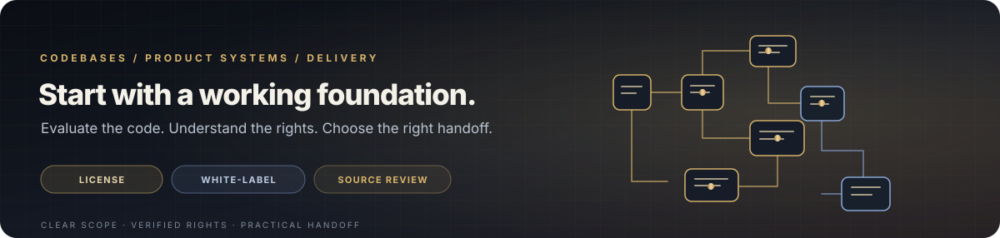

  

  
  
  
  
  

  <a href="#selected-work">Work</a> ·
  <a href="#real-project-data">Proof</a> ·
  <a href="#codebases--commercial-options">Buy / License</a> ·
  <a href="#product-lab">Products</a> ·
  <a href="#engineering-toolkit">Toolkit</a> ·
  <a href="#contact--next-steps">Contact</a>

<strong>Working software. Real constraints. Clear terms.</strong>

<em>Explore products, inspect the source, license or adapt a codebase where permitted, or bring me in to ship the next stage.</em>

---

## The snapshot

I’m **Amit Chakraborty**, a Lead Architect and Senior Full-Stack Engineer based in Kolkata, India, working remotely with teams worldwide. I build mobile and web products, AI-enabled workflows, native performance systems, and the infrastructure behind shipped software.

<table>
  <tr>
    <td align="center" width="25%"><strong>98</strong> Repositories shown on GitHub 24 Oct 2026 snapshot</td>
    <td align="center" width="25%"><strong>3,386</strong> GitHub contributions in the last year Profile snapshot</td>
    <td align="center" width="25%"><strong>948</strong> Private-repository contributions 1–23 Oct 2026</td>
    <td align="center" width="25%"><strong>8+ years</strong> Production engineering 18+ apps reported</td>
  </tr>
</table>

*GitHub activity numbers are a dated profile snapshot, not a proxy for customers or revenue. The outcome metrics below link to their project case studies.*

## Real project data

<table>
  <tr>
    <td valign="top" width="50%">
      
      <h3><a href="https://amitchakraborty.dev/work/aura-arena">Aura Arena</a></h3>
      
<strong>Computer vision · Realtime gameplay</strong>

      <table>
        <tr><td><strong>Sub-16 ms</strong></td><td>Per-frame inference reported on mid-range phones</td></tr>
        <tr><td><strong>Sub-2 s</strong></td><td>PWA time-to-interactive reported on 4G</td></tr>
        <tr><td><strong>1v1</strong></td><td>Realtime multiplayer using Supabase Realtime</td></tr>
      </table>
      React · TypeScript · MediaPipe · WebGPU · Supabase Realtime 
      <a href="https://github.com/devamitch/aura-arena">Source</a> · <a href="https://auraarena.devamit.co.in">Live product</a> · <a href="https://amitchakraborty.dev/work/aura-arena">Case study & measurements</a> 
      
      
    </td>
    <td valign="top" width="50%">
      
      <h3><a href="https://amitchakraborty.dev/work/aura-studio">Aura Studio</a></h3>
      
<strong>Visual AI workflow orchestration</strong>

      <table>
        <tr><td><strong>45+</strong></td><td>Typed workflow node types</td></tr>
        <tr><td><strong>Live</strong></td><td>Per-node response streaming and execution visibility</td></tr>
        <tr><td><strong>Multi-model</strong></td><td>LLM routing and RAG-oriented pipelines</td></tr>
      </table>
      React · TypeScript · React Flow · Zustand · Gemini API 
      <a href="https://github.com/devamitch/aura-workflow-studio">Frontend source</a> · <a href="https://github.com/devamitch/aura-workflow-studio-backend">Backend component</a> · <a href="https://aurastudio.ai">Live app</a> · <a href="https://amitchakraborty.dev/work/aura-studio">Case study</a> 
      
      
    </td>
  </tr>
  <tr>
    <td valign="top" width="50%">
      
      <h3><a href="https://amitchakraborty.dev/work/kshem">KSHEM</a></h3>
      
<strong>Land intelligence · Governance workflows</strong>

      <table>
        <tr><td><strong>20+</strong></td><td>Role-scoped stakeholder portals described in the case study</td></tr>
        <tr><td><strong>Shared spine</strong></td><td>PostGIS + GeoJSON boundary model</td></tr>
        <tr><td><strong>Workflow</strong></td><td>Ownership history, document analysis and dispute checks</td></tr>
      </table>
      Next.js · PostGIS · GeoJSON · Claude AI · GIS 
      <a href="https://kshem.devamit.co.in">Live preview</a> · <a href="https://amitchakraborty.dev/work/kshem">Case study & architecture</a>
    </td>
    <td valign="top" width="50%">
      
      <h3><a href="https://amitchakraborty.dev/work/vulcan-eleven">Vulcan Eleven</a></h3>
      
<strong>Fantasy sports · Performance engineering</strong>

      <table>
        <tr><td><strong>50K</strong></td><td>Peak daily active users reported</td></tr>
        <tr><td><strong>+35%</strong></td><td>Transaction growth reported in the case study</td></tr>
        <tr><td><strong>Sub-10 ms</strong></td><td>Contest-ranking query reported with indexed PostgreSQL</td></tr>
      </table>
      React Native · C++ / JSI · Reanimated · PostgreSQL · Razorpay · Binance Pay 
      <a href="https://apps.apple.com/ua/app/vulcan-eleven/id6462420052">App Store</a> · <a href="https://play.google.com/store/apps/details?id=com.vulcaneleven">Google Play</a> · <a href="https://amitchakraborty.dev/work/vulcan-eleven">Case study & outcomes</a>
    </td>
  </tr>
  <tr>
    <td valign="top" width="50%">
      
      <h3><a href="https://amitchakraborty.dev/work/harmony-bloom">HarmonyBloom</a></h3>
      
<strong>Privacy-first wellness · Telegram Mini App</strong>

      
Client-side AES-256-GCM encryption, Dexie local persistence and an AI coach designed to work with decrypted state in memory. See the case study for the architecture and privacy boundaries.

      Telegram Mini App · Dexie · Framer Motion · Gemini · AES-256-GCM 
      <a href="https://harmonybloom.devamit.co.in">Product</a> · <a href="https://amitchakraborty.dev/work/harmony-bloom">Case study</a>
    </td>
    <td valign="top" width="50%">
      
      <h3><a href="https://amitchakraborty.dev/work/neev">Neev</a></h3>
      
<strong>Private family operating system</strong>

      
Household-scoped spaces, guardian hierarchy, elder oversight and child-safe access boundaries backed by Firebase rules. Designed around family coordination, not attention-maximizing feeds.

      React Native · Expo · TypeScript · Zustand · Firebase 
      <a href="https://neev.devamit.co.in">Product site</a> · <a href="https://github.com/devamitch/neev">Repository</a> · <a href="https://amitchakraborty.dev/work/neev">Case study</a> 
      
    </td>
  </tr>
</table>

<a href="https://amitchakraborty.dev">See all case studies: stakes → architectural decisions → outcomes → evidence →</a>

---

## Codebases & commercial options

  

**Interested in buying, licensing, white-labelling, or extending a codebase?** Start with the codebase catalogue below. Each repository has its own maturity, dependencies, and license status; I confirm those details before quoting or promising rights.

<table>
  <tr>
    <td valign="top" width="50%">
      <h3>01 · License or reuse</h3>
      
Use a suitable existing foundation under the license that actually applies. For projects without an explicit license or with third-party restrictions, permissions must be resolved first.

      
<a href="CODEBASE-CATALOG.md#1-aura-arena">Browse codebase notes →</a>

    </td>
    <td valign="top" width="50%">
      <h3>02 · White-label & customize</h3>
      
Adapt branding, flows, integrations, product requirements and deployment around your business. Quote covers the agreed changes, not an undefined promise of “everything”.

      
<a href="mailto:amit@devamit.co.in?subject=White-label%20or%20customize%20a%20codebase">Discuss a white-label build →</a>

    </td>
  </tr>
  <tr>
    <td valign="top" width="50%">
      <h3>03 · Source acquisition / buyout</h3>
      
Discuss a source transfer or acquisition only after checking ownership, existing licenses, dependencies, assets and prior obligations. An existing open-source grant cannot simply be turned into exclusive ownership.

      
<a href="mailto:amit@devamit.co.in?subject=Source%20code%20acquisition%20discussion">Start an acquisition discussion →</a>

    </td>
    <td valign="top" width="50%">
      <h3>04 · Technical due diligence</h3>
      
Review architecture, setup, dependency risk, data/security boundaries, current limitations and the work required before you invest in a codebase.

      
<a href="mailto:amit@devamit.co.in?subject=Codebase%20technical%20due%20diligence">Request a technical review →</a>

    </td>
  </tr>
  <tr>
    <td valign="top" width="50%">
      <h3>05 · Deploy & hand over</h3>
      
Agree on environment configuration, hosting, CI/CD, release steps, documentation and a handover session. Secrets and third-party accounts remain buyer-owned unless the contract explicitly says otherwise.

      
<a href="mailto:amit@devamit.co.in?subject=Codebase%20deployment%20and%20handoff">Plan deployment →</a>

    </td>
    <td valign="top" width="50%">
      <h3>06 · Custom delivery or ongoing support</h3>
      
Extend a base repo or build a defined workstream. My portfolio lists separate engineering-service packages; codebase licensing is scoped and quoted separately.

      
<a href="https://amitchakraborty.dev">View current service options →</a>

    </td>
  </tr>
</table>

### Featured codebases

| Codebase | What is demonstrable from the project material | Best-fit conversation | Source / current signal |
|:--|:--|:--|:--|
| **Aura Arena** | MediaPipe CV + WebGPU, scoring across 100+ movement sub-disciplines, Supabase Realtime multiplayer, PWA/offline work | CV demos, movement products, fitness or interactive-game foundations | [Repo](https://github.com/devamitch/aura-arena) · [Live](https://auraarena.devamit.co.in) · [Last commit](https://github.com/devamitch/aura-arena/commits/main) |
| **Aura Studio** | 45+ typed node types, multi-model LLM routing, RAG-oriented flows, per-node streaming, export paths described in the README | AI workflow builder, internal automation studio, LLM/RAG prototyping | [Frontend](https://github.com/devamitch/aura-workflow-studio) · [Backend component](https://github.com/devamitch/aura-workflow-studio-backend) · [Live](https://aurastudio.ai) |
| **Neev** | React Native / Expo family OS, household-scoped spaces and Firebase rules described in project documentation | Private family/productivity apps, role-scoped mobile products | [Repo](https://github.com/devamitch/neev) · [Product](https://neev.devamit.co.in) |
| **BlinkQuest website** | Next.js 16 static marketing site, Tailwind CSS v4, structured metadata, sitemap and Cloudflare Workers deployment described in README | Product landing sites, documentation hubs, Cloudflare static deployment | [Website repo](https://github.com/devamitch/blinkquest-site) · [Live](https://blinkquest.devamit.co.in) |

Live repository metadata changes over time. The links above go to the source/history; the exact branch, commit, build state and transferable scope must be confirmed for each deal.

### What a serious buyer should get before paying

- **Scope:** exact repository, branch and commit SHA, what is included and what is excluded.
- **Readiness:** current setup commands, environment-variable inventory, demo/build status, known defects and unfinished areas.
- **Risk:** dependency and third-party asset/license list, external service costs, secret ownership, data/privacy boundaries and deployment dependencies.
- **Terms:** license type or transfer structure, permitted use, exclusivity if legally available, support period, payment milestones and acceptance criteria.
- **Handoff:** install/deploy walkthrough, documented change points, and an agreed post-purchase support option.

**No invented revenue, download counts, “production-ready” guarantee, or made-up repository prices.** Commercial terms depend on the codebase, current IP/license position, scope, and support requirements.

---

## Product lab

| Product | Product direction | Links |
|:--|:--|:--|
| **KSHEM** | Land intelligence, GIS, document analysis and governance workflows | [Product](https://kshem.devamit.co.in) · [Case study](https://amitchakraborty.dev/work/kshem) |
| **HarmonyBloom** | Privacy-first habit and wellness experience built as a Telegram Mini App | [Product](https://harmonybloom.devamit.co.in) · [Case study](https://amitchakraborty.dev/work/harmony-bloom) |
| **Setu** | Android-first local-first sharing, nearby discovery and native device capabilities | [Product](https://setu.devamit.co.in) · [Build notes](https://dev.to/techamit95ch/building-setu-a-local-first-sharing-experience-for-android-looking-for-early-testers-1inl) |
| **BlinkQuest** | Mindful eye breaks and gamified screen-wellness experience for Android | [Product site](https://blinkquest.devamit.co.in) · [Website source](https://github.com/devamitch/blinkquest-site) |
| **Project Scope** | Project scoping and engineering planning | [Open tool](https://projectscopes.devamit.co.in) |
| **Interview Prep** | Coding drills and system-design preparation | [Portfolio hub](https://amitchakraborty.dev) |

## Production work

<strong>HealthTech & AI · Synapsis Medical Technologies</strong>

Contributed to the technical foundation of a HealthTech AI startup and five production apps. Client-specific implementation details are kept high-level where work is proprietary.

- **AI-assisted clinical workflows:** patient engagement and triage experiences.
- **Retrieval-backed medical workflows:** RAG and LLM integration, with a 99.9% uptime figure reported in prior portfolio material.
- **Computer vision:** MediaPipe-based real-time vision and luminance-analysis work on consumer hardware.
- **Engineering delivery:** work growing the team from 0 to 21, alongside architecture documentation, CI/CD, cloud infrastructure and cross-platform delivery.

<strong>FinTech, Web3, consumer & gaming · NonceBlox</strong>

| Project | Focus | Public reference |
|:--|:--|:--|
| **Vulcan Eleven** | Fantasy sports, native mobile performance, real-time rankings, fiat/crypto payment flows | [Case study](https://amitchakraborty.dev/work/vulcan-eleven) · [iOS](https://apps.apple.com/ua/app/vulcan-eleven/id6462420052) · [Android](https://play.google.com/store/apps/details?id=com.vulcaneleven) |
| **Housezy** | PropTech, subscription housing, geospatial search and real-time APIs | [iOS](https://apps.apple.com/us/app/housezy/id6471949955) · [Android](https://play.google.com/store/apps/details?id=com.nonceblox.housezy) |
| **MusicX** | Web3 music competition, royalty distribution and NFT rewards | [iOS](https://apps.apple.com/us/app/music-x/id6475713772) |
| **DeFi11** | On-chain fantasy sports and NFT marketplace | [iOS](https://apps.apple.com/app/defi11-fantasy-sports-app/id1608967244) · [Case study](https://amitchakraborty.dev/work/defi11) |
| **Memr** | Web3 whale tracking and wallet-connected frontend | Product/source not publicly linked here |
| **BlockBet** | Web3 prediction-market experience | Product/source not publicly linked here |
| **Be4You** | Dating MVP, WebRTC video, realtime chat and geospatial discovery | Private client work |
| **WeFoU** | Proximity social network, maps and realtime feeds | Private client work |
| **CryptoCoffeeTales** | Blockchain news and IPFS-backed content | [Google Play](https://play.google.com/store/apps/details?id=com.nonceblox.cryptocoffetales) |
| **JCare** | Community donations and foundation support | [Google Play](https://play.google.com/store/apps/details?id=com.nonceblox.jitendrafoundationapp) |
| **Bingo** | Offline merchant billing and Bluetooth tethering | [Google Play](https://play.google.com/store/apps/details?id=com.nonceblox.bingo) |
| **HRMS** | Electron desktop employee-management product | Internal |
| **Food Shala** | Consumer mobile product | [Repository](https://github.com/devamitch/food_shala) |

<strong>GovTech & enterprise · TechProMind / WebSkitters</strong>

- **GST ecosystem:** connected PHP portal, VB.NET desktop tooling, and Java/Kotlin Android application.
- **Government projects:** portal delivery and security hardening across 13+ projects, as reported in the portfolio.
- **Retailer software:** desktop and operational workflows.
- **Modernization:** PHP-to-Angular/REST migrations and Oracle/MySQL data pipelines.

## Public engineering repositories

A useful starting point for source review. Repository maturity varies: these include product code, supporting components, starters, experiments and learning repos.

<table>
  <tr>
    <td valign="top" width="50%">
      <h3>AI & product systems</h3>
      
<a href="https://github.com/devamitch/aura-arena">aura-arena</a> — movement CV and realtime play

      
<a href="https://github.com/devamitch/aura-workflow-studio">aura-workflow-studio</a> — visual AI frontend

      
<a href="https://github.com/devamitch/aura-workflow-studio-backend">aura-workflow-studio-backend</a> — workflow backend component

      
<a href="https://github.com/devamitch/neev">neev</a> · <a href="https://github.com/devamitch/neev-site">neev-site</a> — family OS app & website

      
<a href="https://github.com/devamitch/blinkquest-site">blinkquest-site</a> — wellness product website

    </td>
    <td valign="top" width="50%">
      <h3>Mobile, health & diagnostics</h3>
      
<a href="https://github.com/devamitch/audio-therapy-app">audio-therapy-app</a>

      
<a href="https://github.com/devamitch/clinic-management-app">clinic-management-app</a> · <a href="https://github.com/devamitch/clinic-mobile-app">clinic-mobile-app</a>

      
<a href="https://github.com/devamitch/health-pulse-mobile-app">health-pulse-mobile-app</a>

      
<a href="https://github.com/devamitch/diagnostic-pip-app">diagnostic-pip-app</a> · <a href="https://github.com/devamitch/diagnostic-station-web">diagnostic-station-web</a>

      
<a href="https://github.com/devamitch/diagnostic-station-desktop">diagnostic-station-desktop</a>

      
<a href="https://github.com/devamitch/eye-scan-mobile-app">eye-scan-mobile-app</a> · <a href="https://github.com/devamitch/eye-scan-pwa-app">eye-scan-pwa-app</a> · <a href="https://github.com/devamitch/eye-scan-matrix-portal">eye-scan-matrix-portal</a>

    </td>
  </tr>
  <tr>
    <td valign="top" width="50%">
      <h3>Web3 & platform</h3>
      
<a href="https://github.com/devamitch/cryptoverse">cryptoverse</a>

      
<a href="https://github.com/devamitch/nextjs-wagmi-starter">nextjs-wagmi-starter</a>

      
<a href="https://github.com/devamitch/nest-portfolio-backend">nest-portfolio-backend</a>

      
<a href="https://github.com/devamitch/merchantplatform">merchantplatform</a>

    </td>
    <td valign="top" width="50%">
      <h3>Starters & other work</h3>
      
<a href="https://github.com/devamitch/react-native-starter">react-native-starter</a> · <a href="https://github.com/devamitch/expo-boilerplate">expo-boilerplate</a>

      
<a href="https://github.com/devamitch/admin-template-scss">admin-template-scss</a> · <a href="https://github.com/devamitch/react-basic-admin-template">react-basic-admin-template</a>

      
<a href="https://github.com/devamitch/appointment-booking-app">appointment-booking-app</a>

      
<a href="https://github.com/devamitch/fitness-pro-app">fitness-pro-app</a> · <a href="https://github.com/devamitch/food_shala">food_shala</a>

    </td>
  </tr>
</table>

<a href="https://github.com/devamitch?tab=repositories">Explore all repositories →</a>

## Engineering toolkit

<table>
  <tr>
    <td valign="top" width="50%"><h3>Mobile & native</h3>
React Native · Expo · JSI / TurboModules · Reanimated · Kotlin · Swift · C++
</td>
    <td valign="top" width="50%"><h3>Web & product UI</h3>
React · Next.js · TypeScript · Tailwind CSS · React Flow · Zustand
</td>
  </tr>
  <tr>
    <td valign="top" width="50%"><h3>AI & computer vision</h3>
LLM APIs · RAG · routing/evaluation workflows · MediaPipe · WebGPU · vector search
</td>
    <td valign="top" width="50%"><h3>Backend & data</h3>
Node.js · NestJS · REST · GraphQL · PostgreSQL · PostGIS · MongoDB · Redis
</td>
  </tr>
  <tr>
    <td valign="top" width="50%"><h3>Cloud & delivery</h3>
CI/CD · release engineering · crash reporting · deployment and handoff
</td>
    <td valign="top" width="50%"><h3>Web3 & payments</h3>
Solidity · Ethereum · WalletConnect · Wagmi · Viem · IPFS · Razorpay · Binance Pay · PayU
</td>
  </tr>
</table>

## Engineering principles

- **Measure the constraint.** Frame budgets, latency, release time and failure modes are product requirements.
- **Separate facts from assumptions.** Product claims link to case studies; live GitHub signals use the actual repository.
- **Design for operations.** CI/CD, observability, rollback paths, dependencies and operating cost belong in the architecture.
- **Make handoff part of the product.** Setup instructions, license clarity and a list of known gaps make code easier to trust and extend.

## GitHub activity

  
  

  

Third-party stats cards can occasionally be unavailable. Language charts describe public repository contents, not proficiency or commercial readiness.

## Writing & notes

- [Engineering notes and case studies](https://amitchakraborty.dev/blog)
- [Building Setu: a local-first sharing experience for Android](https://dev.to/techamit95ch/building-setu-a-local-first-sharing-experience-for-android-looking-for-early-testers-1inl)

## Education

- **MCA — Master of Computer Applications**, Techno Main Salt Lake, Kolkata · 2018–2021 · 8.61 CGPA
- **BCA — Bachelor of Computer Applications**, The Heritage Academy, Kolkata · 2014–2017 · 7.3 DGPA

## Contact & next steps

  
  
  

To get a useful quote, include the **repository/product**, intended use, preferred option (license, white-label, source acquisition, deployment, audit, or custom build), budget range, timeline and support requirements. I’ll confirm current scope and licensing before promising a transfer or exclusive rights.

- **Portfolio:** [amitchakraborty.dev](https://amitchakraborty.dev) · [devamit.co.in](https://devamit.co.in)
- **LinkedIn:** [linkedin.com/in/devamitch](https://linkedin.com/in/devamitch)
- **Email:** [amit@devamit.co.in](mailto:amit@devamit.co.in)
- **Codebase buyer guide:** [CODEBASE-CATALOG.md](CODEBASE-CATALOG.md)

  

